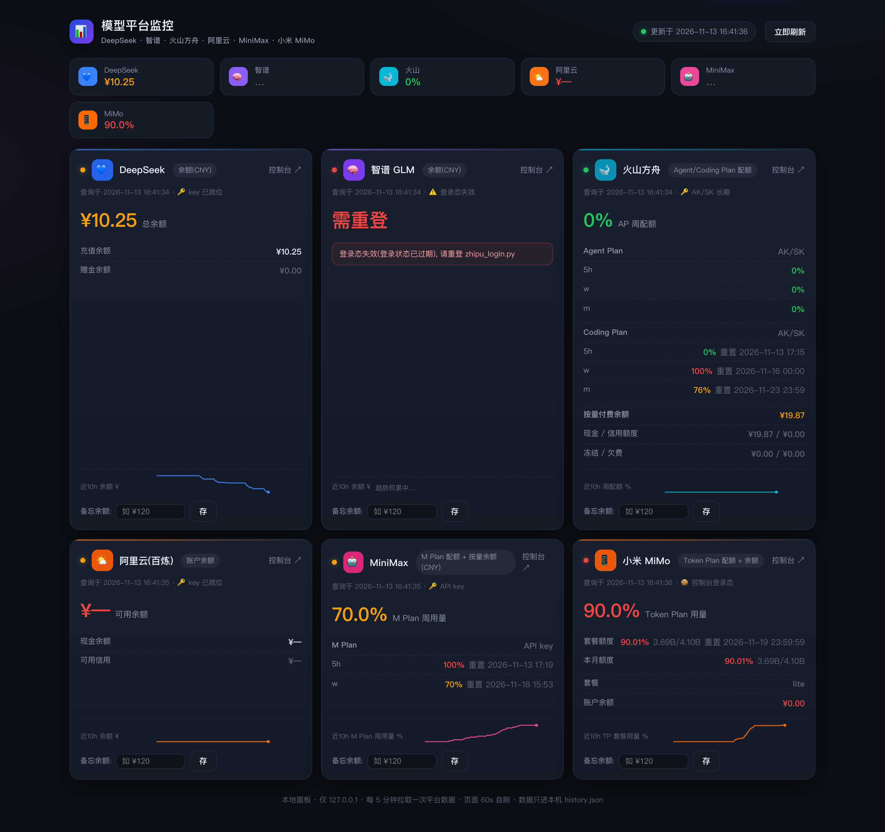
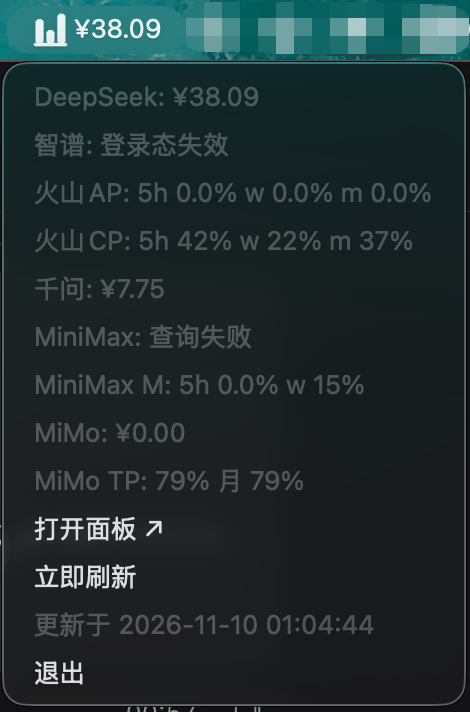

# Token Monitor · AI 订阅额度监控

> 一个只跑在**本机**的轻量监控：把你在各家 AI 平台的**余额 / 套餐额度 / 套餐用量**汇总到
> 一个网页面板 + macOS 顶部菜单栏。零第三方依赖（数据服务仅用 Python 标准库），不上传任何数据。

**支持 6 家平台**：DeepSeek · 智谱 GLM · 火山方舟（Agent Plan + Coding Plan）· 阿里云百炼 · MiniMax（M Plan）· 小米 MiMo（Token Plan）

<p align="center">
  
  
</p>

<p align="center"><sub><b>左：</b>网页面板（卡片 + 趋势线）　<b>右：</b>macOS 菜单栏下拉（顶部图标常驻，不占 Dock）</sub></p>

> 截图说明：<b>智谱</b>卡片展示的是登录态过期时的样子 —— 会明确写出原因和修复命令，不会静默失败；<b>MiniMax</b> 余额同理（M Plan 配额仍正常显示）。

---

## 能监控什么

| 平台 | 监控内容 | 认证方式 |
|---|---|---|
| **DeepSeek** | 账户余额（充值 / 赠金） | API Key |
| **智谱 GLM** | 余额、累计充值与消费；Coding Plan 的 5h / 周用量 | API Key + 控制台登录态 |
| **火山方舟** | **Agent Plan** 与 **Coding Plan** 两套套餐的 5h / 周 / 月用量与重置时间；**按量付费账户余额**（可用 / 现金 / 信用额度 / 冻结 / 欠费） | 套餐：AK/SK 直查 OpenAPI（无权限时回落 `arkcli` SSO）；余额：Billing OpenAPI `QueryBalanceAcct`（需 `billing:QueryBalanceAcct` 权限） |
| **阿里云百炼** | 账户余额 | 只读 RAM 子账号 AK/SK |
| **MiniMax** | **M Plan** 的 5h / 周用量；按量余额 | API Key（额度）/ 控制台登录态（余额） |
| **小米 MiMo** | **Token Plan** 套餐用量（含本月）、余额、套餐周期 | 控制台登录态 + 请求签名 |

每种指标的展示形态：

- **网页面板** `http://127.0.0.1:8317` — 卡片式汇总、近期趋势线（sparkline）、跳转各平台控制台、本地"备忘余额"手填
- **菜单栏** — 顶部常驻图标（不占 Dock），下拉逐行显示各平台关键数字：

  ```
  DeepSeek: ¥38.09
  智谱: 登录态失效
  火山AP: 5h 0.0% w 0.0% m 0.0%
  火山CP: 5h 42% w 22% m 37%
  火山余额: ¥19.87
  千问: ¥7.75
  MiniMax M: 5h 0.0% w 15%
  MiMo: ¥0.00
  MiMo TP: 79% 月 79%
  ```
- **JSON API** — `/api/status`、`/api/poll`、`/api/history`，方便接自己的脚本/桌面组件

## 快速开始

```bash
git clone https://github.com/Krislu1221/token-monitor.git ~/model-monitor
cd ~/model-monitor

python3 -m venv .venv
.venv/bin/pip install -r requirements.txt

cp config.example.json config.json   # 填入你自己的密钥（该文件已被 .gitignore 排除）
./scripts/install.sh                 # 安装开机自启（数据服务 + 菜单栏）
```

打开 <http://127.0.0.1:8317> 看面板；菜单栏出现图标后，下拉即可看各平台数字。

只想先看网页面板（不装服务、不要菜单栏）：

```bash
./scripts/install.sh --panel         # 前台跑，Ctrl-C 结束
```

停止 / 查看状态：

```bash
./scripts/install.sh unload
./scripts/install.sh status
```

## 配置

密钥支持三种来源，**优先级从高到低**：

1. **环境变量**（见 `.env.example`）
2. **`config.json`**（推荐；`config.example.json` 复制后填写）
3. **`.creds/*.env`**（各平台登录/签名状态文件，自动管理）

```json
{
  "deepseek": "sk-...",
  "zhipu": "...",
  "volc_agent_plan": "ark-...",
  "volc_ak": "AKLT...",
  "volc_sk": "...",
  "minimax": "sk-cp-...",
  "qwen": "sk-...",
  "aliyun_ak": "LTAI...",
  "aliyun_sk": "..."
}
```

> 只填你有的平台即可；缺哪个就在面板上显示"待配置"，不影响其它平台。

也可以用 `TOKEN_MONITOR_CONFIG=/path/to/my.json` 指定配置文件位置。

## 需要登录态的平台

部分平台的用量接口只对**控制台会话**开放（推理 Key 读不到），需要各自登录一次：

| 平台 | 命令 | 说明 |
|---|---|---|
| 小米 MiMo | `.venv/bin/python mimo_login.py` | 弹独立 Chrome 登录一次；之后 `--auto` 可无头续期 |
| 智谱 GLM | `.venv/bin/python zhipu_login.py` | 扫码登录 |
| MiniMax（余额） | `.venv/bin/python minimax_login.py` | 弹独立 Chrome 登录 |

登录态保存在 `.creds/`（权限 600，**已在 .gitignore 中排除**）。会话过期时对应行会显示"需重登"，重跑一次登录脚本即可。

> 登录辅助脚本用 Playwright + 本机 Chrome（`channel="chrome"`），需要先装 Chrome：
> `.venv/bin/playwright install`

### 小米 MiMo 的请求签名

MiMo 控制台 API 在 2026-11 起要求请求签名（只带 cookie 会返回 `403 SIGN_MISSING`）。本项目已实现：

1. `GET /api/v1/user/sign-key` 取按天轮换的 `signKey`；
2. 业务请求带 `X-Sign` / `X-Timestamp` / `X-Key-Epoch` / `X-Timezone`；
3. `canonical = METHOD\n完整路径\n排序后的query\nbodyHash\ntimestamp`，
   `X-Sign = HMAC-SHA256(canonical, signKey)`；
4. 签名失效时自动重取密钥重试一次，并用响应头 `x-server-time` 校准本机时钟偏差。

详见 `poller.py` 的 `_mimo_sign_key()` / `_mimo_signed_get()`。

### 火山引擎「按量付费」余额

火山有两套账：**套餐额度**（Agent Plan / Coding Plan）和**按量付费账户余额**，两者互不相干。

余额走 Billing OpenAPI（`billing.volcengineapi.com`，Action `QueryBalanceAcct`，Version `2022-01-01`），用同一个 AK/SK 签名，需要该子账号具备 `billing:QueryBalanceAcct` 权限（预置策略 `BillingCenterReadOnlyAccess` 即可）。返回可用余额、现金余额、信用额度、冻结金额与欠费。

没有权限时面板会明确显示「缺 billing 权限」，不影响套餐额度那两行。


## 打包成 macOS App（可选）

```bash
cd packaging/build
./build-app.sh          # 组装 → ad-hoc 签名 → 安装到 /Applications/Token monitor.app
```

App 是个薄壳：双击 → 确保后台服务在跑 → 打开面板 → 自己退出。
**关掉 App 或面板页面，监控仍在后台运行**（由 launchd 托管）。

默认从 `~/model-monitor` 找程序；装到别处时设置 `TOKEN_MONITOR_DIR=/你的路径`。

> 从 Release 下载的 `.app` 是 **ad-hoc 签名（未公证）**，首次打开可能被 Gatekeeper 拦。
> 右键 → 打开，或执行：`xattr -dr com.apple.quarantine "/Applications/Token monitor.app"`

## 结构

```
poller.py          # 数据服务：采集各平台 + HTTP API + 每 5 分钟轮询（标准库）
menubar.py         # 菜单栏（rumps）
dashboard.html     # 网页面板（内嵌在 poller 里提供）
volc_usage_cli.py  # 火山套餐用量 CLI（也可被其它程序调用）
mimo_login.py      # 小米 MiMo 登录 / 自动续期
minimax_login.py   # MiniMax 登录
zhipu_login.py     # 智谱登录
scripts/install.sh # 安装器（生成 launchd plist）
packaging/         # macOS .app 打包
```

数据流：`poller.py` 每 5 分钟拉一次各平台 → 写 `status.json` + `history.json` → 面板与菜单栏读它。
全部在本机完成，**没有任何数据外发**。

## 安全说明

- HTTP 服务只绑定 `127.0.0.1:8317`（不对外网开放）
- 密钥、登录态、历史数据都在本地，且被 `.gitignore` 排除
- 仓库中不含任何真实密钥；`probe_*.py` 之类的一次性调试脚本未收录
- 平台接口属于**非公开接口**，随时可能变更；失效时面板会显示具体原因而不是静默失败

## 常见问题

**Q：菜单栏没有图标？**
`rumps` 没装或服务未启动：`.venv/bin/pip install rumps`，然后 `./scripts/install.sh`。

**Q：某个平台显示"查询失败"？**
面板卡片里会显示原始错误（HTTP 状态 / 平台返回 code）。常见原因：Key 失效、登录态过期、需要的权限没给（如火山 Coding Plan 需要 `ark:GetCodingPlanUsage`）。

**Q：会不会把我的 key 传到别处？**
不会。代码里没有任何上报逻辑，唯一的出站请求是去各平台官方接口取你自己的余额。

## License

MIT
